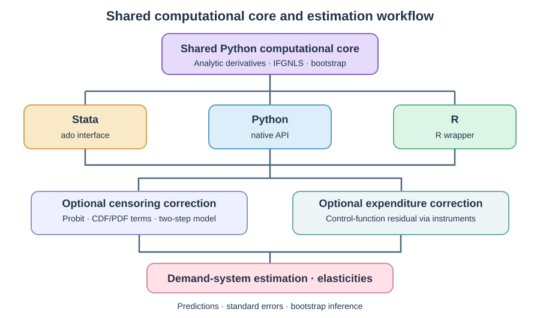

# Summary

In demand-system applications, censoring refers to observations in which a household reports zero expenditure on a good during the survey period, resulting in a zero observed budget share for that good. These zeros create a practical problem when estimating complete demand systems. Dropping households with zero purchases or failing to account for censoring can affect estimates of demand parameters and elasticities.

To address this, we created `pyquaidsce`, an open-source package for estimating the Almost Ideal Demand System (AIDS; @deaton1980aids) and the Quadratic Almost Ideal Demand System (QUAIDS; @banks1997), while accounting for censoring with the Shonkwiler and Yen (@shonkwiler1999) approach. It supports both censored and uncensored models, demographic characteristics based on Ray scaling [@ray1983], a control-function approach for potentially endogenous total expenditure, demand elasticities, and bootstrap inference with parallelization.

A single Python computational core is used by the Python, Stata, and R interfaces. Researchers can therefore use the same estimation method and post-estimation calculations in all three software tools for quantitative analysis. The package is designed mainly for applied economists working with household expenditure data to estimate censored demand systems.

# Statement of need

Demand-system models are widely used in many fields of economics to study how households change their spending when prices, income, taxes, or subsidies change. In these fields, researchers often work with large household surveys in which many households report no purchases of some goods during the survey period.

These zero expenditures can occur for several reasons. A household may not want to buy a good or may be unable to afford it. Some goods may also be unavailable, while others are purchased only occasionally. For example, a household may buy a product during the year but report zero expenditure on it during the survey period [@caro2021working].

Standard demand systems, such as AIDS and QUAIDS, do not directly address this censoring problem, which can result in biased parameter and elasticity estimates [@heien1990; @yen2004]. To address this, `pyquaidsce` implements the two-step approach of @shonkwiler1999. In this approach, a separate Probit participation model is first estimated for each good, and the resulting cumulative distribution function (CDF) and probability density function (PDF) terms are then included in the demand system.

In addition to censoring correction, the package also supports a control-function correction when total expenditure may be endogenous. If not addressed, this endogeneity could also result in biased estimates. For endogeneity correction, users provide excluded instruments, and the package estimates the required first-stage expenditure equation before fitting the demand system [@rivers1988; @lecocq2015].

The intended users are empirical economists and policy researchers working with household expenditure data. The package fits only cross-sectional income-expenditure data, so dynamic purchasing behavior, stockpiling, and household-level panel dynamics are outside its current scope.

# State of the field

Several established software packages cover parts of the demand-system workflow. In Stata, `quaids` estimates AIDS and QUAIDS models with demographic effects [@poi2012], `aidsills` provides tools for instrumental-variable estimation [@lecocq2015], and `demandsys` supports several demand-system specifications [@statacorp2023]. In R, `micEconAids` provides estimation and post-estimation tools for AIDS models [@henningsen2022]. However, these packages do not correct for reported zero expenditures.

The direct predecessor of `pyquaidsce` is the Stata `quaidsce` command [@caro2021working; @caro2021module]. Unlike the other packages, `quaidsce` allows adjusting for censoring. `quaidsce` has been available as a Stata module and has been used in published applied demand studies. Recent examples include food-tax analysis in Costa Rica [@roche2025], demand for dairy milk and plant-based alternatives in the United States [@capps2024], and household food-demand and welfare analysis in The Gambia [@vorsah2026]. These applications show that censored AIDS and QUAIDS estimation already serves an active research need.

The new project keeps the same underlying censored AIDS and QUAIDS framework, but changes how the estimation is implemented. The original Stata command relies on Stata's `nlsur` framework for nonlinear demand-system estimation. For the changes needed to reduce computation time, Python gave us more direct control over the estimation routine. It also made it possible to build one computational core that could be used from Python, Stata, and R.

`pyquaidsce` therefore extends `quaidsce` in three main directions. It reduces the computational cost of large censored demand systems, makes the same estimator available through three software tools for quantitative analysis, and adds features such as built-in bootstrap inference and a control-function correction for endogenous total expenditure. The common Python core also provides a base for adding further methods in future releases.

# Software design

The Python, Stata, and R interfaces of `pyquaidsce` share a single Python computational core. This architecture ensures that estimation and post-estimation follow the same procedures across the three interfaces. Figure 1 illustrates the shared architecture and its main components. Installation instructions and examples are available in the [repository documentation](https://github.com/sinaamiri9000-collab/pyquaidsce/tree/main/docs).

{#fig:architecture width="100%"}

# Econometric specification

The QUAIDS model implemented in `pyquaidsce` follows @banks1997, with demographic scaling based on @ray1983. For good $i$, the latent budget share is

$$
w_i^*=\alpha_i+\sum_{j=1}^{J}\gamma_{ij}\ln p_j+
\left(\beta_i+\sum_{r=1}^{R}\eta_{ri}z_r\right)D+
\frac{\lambda_iD^2}{b(\mathbf p)c(\mathbf p,\mathbf z)}.

$$

where

$$
D=\ln y-\ln a(\mathbf p)-\ln\bar m(\mathbf z),

$$

$$
\ln a(\mathbf p)=\alpha_0+\sum_{i=1}^{J}\alpha_i\ln p_i+
\frac12\sum_{i=1}^{J}\sum_{j=1}^{J}\gamma_{ij}\ln p_i\ln p_j,

$$

and

$$
\begin{aligned}
b(\mathbf p)&=\exp\left(\sum_{i=1}^{J}\beta_i\ln p_i\right),\\
\bar m(\mathbf z)&=1+\sum_{r=1}^{R}\rho_r z_r,\\
c(\mathbf p,\mathbf z)&=\exp\left(\sum_{i=1}^{J}\sum_{r=1}^{R}\eta_{ri}z_r\ln p_i\right).
\end{aligned}

$$

Here, $w_i^*$ is the latent budget share of good $i$, $p_i$ is the price of good $i$, $y$ is total expenditure, and $z_r$ is demographic characteristic $r$. The terms $J$ and $R$ denote the numbers of goods and demographic characteristics, respectively. The corresponding demand-system parameters are $\alpha_i$, $\gamma_{ij}$, $\beta_i$, $\lambda_i$, $\eta_{ri}$, and $\rho_r$, while $\alpha_0$ is a user-specified constant. The AIDS specification is obtained by setting $\lambda_i=0$.

To maintain consistency with demand theory, symmetry and homogeneity are imposed through

$$
\gamma_{ij}=\gamma_{ji},\qquad
\sum_{j=1}^{J}\gamma_{ij}=0\quad\forall i,

$$

and the demographic coefficients satisfy

$$
\sum_{i=1}^{J}\eta_{ri}=0\quad\forall r.

$$

For uncensored specifications, the standard adding-up restrictions

$$
\sum_{i=1}^{J}\alpha_i=1,\quad
\sum_{i=1}^{J}\beta_i=0,\quad
\sum_{i=1}^{J}\lambda_i=0

$$

are also imposed, and one demand equation is omitted to avoid singularity of the error covariance matrix. In censored specifications, these adding-up restrictions are relaxed because the Shonkwiler–Yen transformation does not require the observed transformed budget shares to sum to unity. Consequently, all $J$ demand equations are estimated.

For the censored specification, let $w_i$ denote the observed budget share of good $i$, and define the observed participation indicator as

$$
d_{i}=\begin{cases}
1, & w_{i}>0, \\
0, & w_{i}=0
\end{cases}

$$

A separate binary Probit participation model is estimated for each good. Let $d_i^*$ denote the latent propensity to purchase:

$$
d_{i}^{*}=\mathbf{x}_{i}^{\mathsf{T}}\boldsymbol{\tau}_{i}
+\psi_{i}\widehat{v}+\nu_{i},\qquad
d_{i}=I(d_{i}^{*}>0),

$$

where $\mathbf x_i$ is the vector of regressors in the participation equation, $\boldsymbol\tau_i$ is the corresponding coefficient vector, and $\nu_i$ is the Probit error term. When the control-function correction for potentially endogenous total expenditure is used, $\widehat v$ is the generated residual from the first-stage expenditure equation and $\psi_i$ is its equation-specific coefficient in the participation model.

The fitted linear index of the participation model is

$$
s_{i}=\mathbf{x}_{i}^{\mathsf{T}}\widehat{\boldsymbol{\tau}}_{i}
+\widehat{\psi}_{i}\widehat{v},

$$

from which

$$
\Phi_i=\Phi(s_i),\qquad \phi_i=\phi(s_i),

$$

where $\Phi(\cdot)$ and $\phi(\cdot)$ denote the cumulative distribution function (CDF) and probability density function (PDF) of the standard normal distribution, respectively.

Following @shonkwiler1999, the censored budget-share equation is

$$
w_i=\Phi_i(w_i^*+\kappa_i\widehat v)+\delta_i\phi_i+\varepsilon_i.

$$

Here, $\kappa_i$ is the equation-specific coefficient on the expenditure control-function residual in the demand equation, $\delta_i$ is the censoring-correction parameter, and $\varepsilon_i$ is the second-stage error. When the built-in expenditure control function is used, the generated residual enters both participation and demand equations, with separate coefficients $\psi_i$ and $\kappa_i$, respectively. Alternatively, users can supply externally computed residuals to either stage or both. When no expenditure-endogeneity correction is requested, the control-function terms are omitted.

Because the Probit terms and, when applicable, the control-function residual are generated from first-stage models, inference should account for their estimation uncertainty [@murphy1985]; `pyquaidsce` addresses this through the nonparametric bootstrap.

The package reports expenditure, uncompensated (Marshallian), and compensated (Hicksian) price elasticities. All elasticities are evaluated at the sample means. The expenditure and uncompensated price elasticities are

$$
e_i=1+\frac{1}{w_i}\frac{\partial w_i}{\partial\ln y},
\qquad
e^u_{ij}=-I(i=j)+\frac{1}{w_i}\frac{\partial w_i}{\partial\ln p_j},

$$

and the compensated price elasticity is obtained from the Slutsky relation,

$$
e^c_{ij}=e^u_{ij}+e_iw_j.

$$

Here, $e_i$ is the expenditure elasticity of good $i$, while $e^u_{ij}$ and $e^c_{ij}$ are the uncompensated and compensated price elasticities of good $i$ with respect to the price of good $j$, respectively. The indicator $I(i=j)$ equals one when $i=j$ and zero otherwise.

These elasticity measures provide a direct way to examine how censoring correction affects estimated demand responses. We illustrate this by estimating censored and uncensored QUAIDS models for ten food groups using data from 37,656 Iranian households (Figure 2).

{#fig:elasticities width="100%"}

As Figure 2 shows, accounting for censoring produces noticeable differences in estimated expenditure and own-price elasticities. The absolute own-price elasticities are larger with censoring correction in all ten food groups. The censoring-correction coefficient $\delta$ is also statistically different from zero in eight of the ten demand equations, highlighting the importance of accounting for zero purchases.

# Research impact statement

The published applications of the original Stata `quaidsce` command demonstrate an established need for censored demand-system estimation. Building on this framework, `pyquaidsce` provides a shared implementation for Python, Stata, and R while substantially reducing computation time. These improvements are particularly valuable for empirical studies that require repeated estimation for specification checks, sensitivity analysis, and statistical inference based on many bootstrap replications.

We compared `pyquaidsce` with Stata `quaidsce` using the same four-good model and 2,665 observations. Both implementations used iterated feasible generalized nonlinear least squares (IFGNLS) and completed 200 bootstrap replications.

| Implementation | Estimation time |
|:---------------|----------------:|
| `pyquaidsce` | 122 s (about 2 min) |
| Stata `quaidsce` | 10,810 s (about 3 h) |

: Performance comparison using 200 bootstrap replications.

Both implementations were run through Stata using eight parallel workers on an AMD Ryzen 7 7730U processor. `pyquaidsce` was 88.6 times faster, with closely matching point estimates. This reduction in computation time makes repeated estimation more practical in computationally intensive demand-system applications.

`pyquaidsce` is also being used in an ongoing empirical study of household demand and taxes on added-sugar products in Iran. This study estimates an 11-group censored QUAIDS model with demographic effects, a correction for endogenous total expenditure, bootstrap inference, and policy simulations.

# AI usage disclosure

Generative AI tools, including ChatGPT (OpenAI), were used for selected coding, debugging, test development, documentation, and manuscript editing. The authors determined the econometric methods, software design, validation strategy, and interpretation of the results. AI-assisted code and text were reviewed by the authors. Software behavior was checked through automated tests, numerical comparisons, cross-interface tests, and inspection of benchmark results. The authors take full responsibility for the software and manuscript.

# Acknowledgements

The authors acknowledge the earlier development of the Stata `quaidsce` command, which provided the starting point for the present software.

# References
